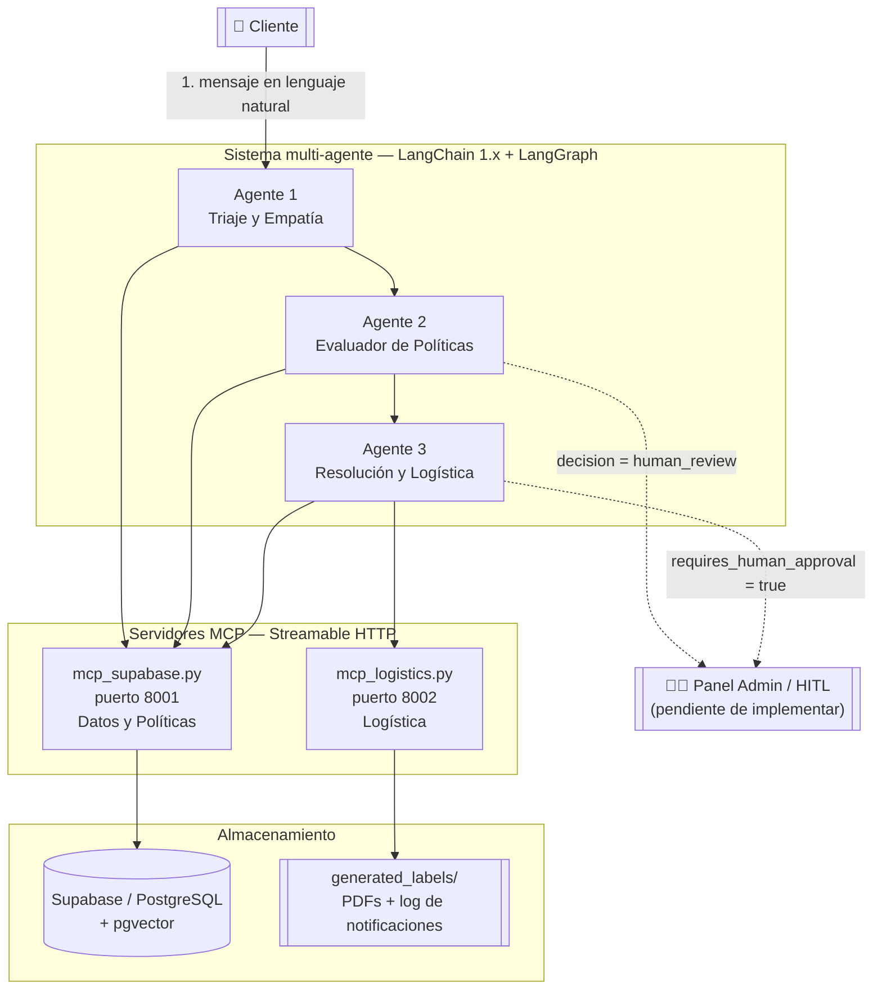
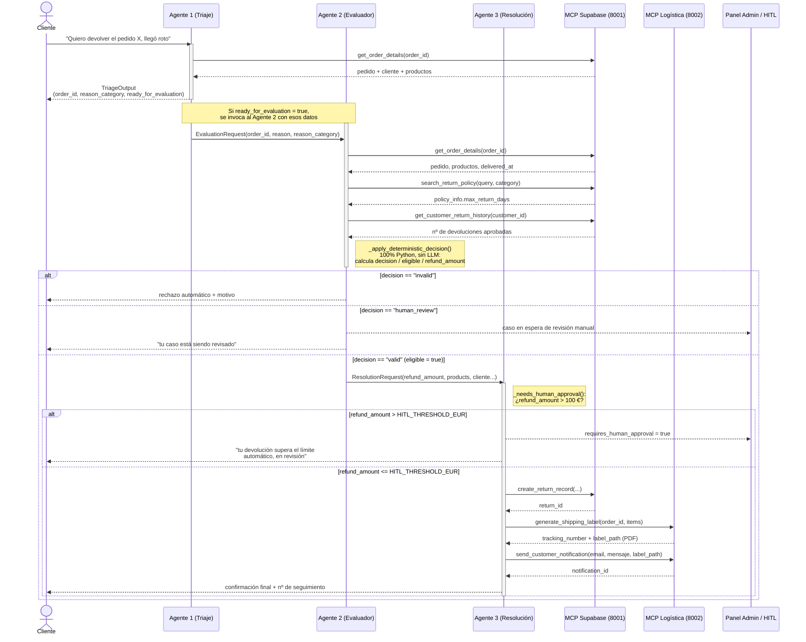
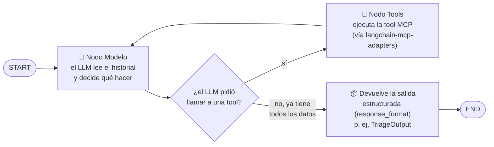
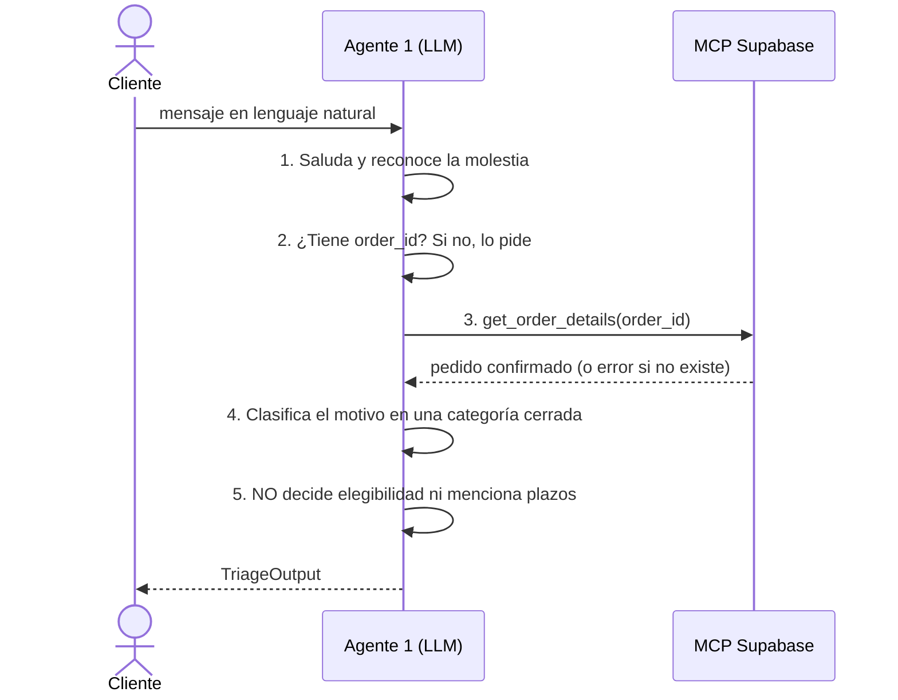
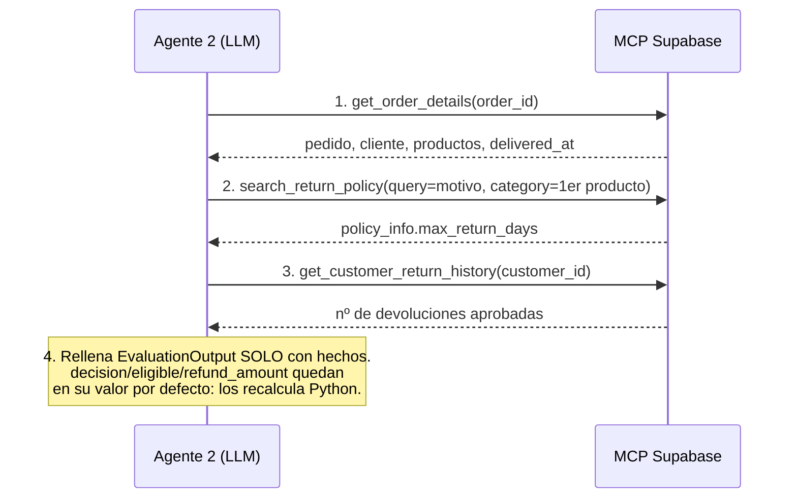
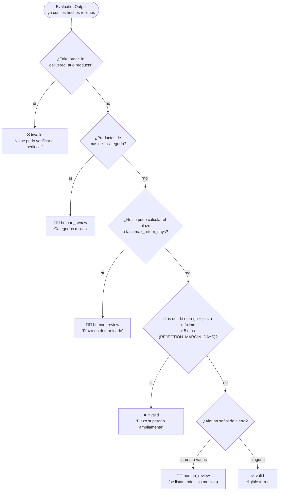
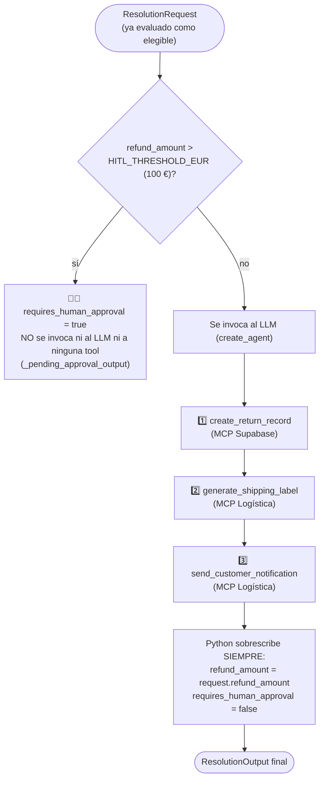
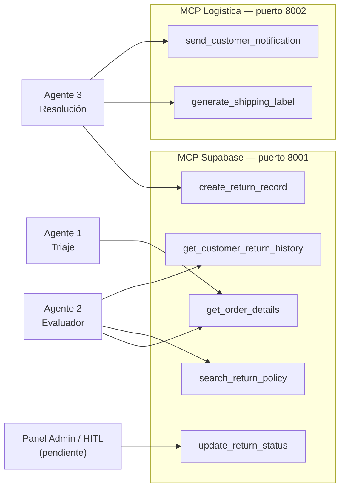

# Flujo conversacional y arquitectura de los 3 agentes

Documentación técnica de cómo se resuelve una devolución en ReFlow, de principio a fin:
qué agente hace qué, en qué orden habla con qué servidor MCP, y qué decide cada uno con
código Python determinista en vez de dejárselo al LLM.

Este documento complementa (no sustituye) al README de cada agente
([`agente1ConMCP/README.md`](../agente1ConMCP/README.md),
[`agente2ConMCP/README.md`](../agente2ConMCP/README.md),
[`agente3ConMCP/README.md`](../agente3ConMCP/README.md)) y al diseño funcional de
[`doc/guia.md`](guia.md). Aquí el foco es **visual**: diagramas de secuencia y de flujo
para entender el sistema sin tener que leer el código primero.

## Índice

1. [Glosario rápido](#glosario-rápido)
2. [Arquitectura general](#arquitectura-general)
3. [Ciclo conversacional completo (diagrama de secuencia)](#ciclo-conversacional-completo-diagrama-de-secuencia)
4. [El grafo interno de un agente (LangGraph)](#el-grafo-interno-de-un-agente-langgraph)
5. [Agente 1: Triaje y Empatía](#agente-1-triaje-y-empatía)
6. [Agente 2: Evaluador de Políticas](#agente-2-evaluador-de-políticas)
7. [Agente 3: Resolución y Logística](#agente-3-resolución-y-logística)
8. [Servidores MCP: quién puede llamar a qué](#servidores-mcp-quién-puede-llamar-a-qué)
9. [Casos de ejemplo (`demo_flujo_completo.py`)](#casos-de-ejemplo-demo_flujo_completopy)

## Glosario rápido

| Término | Significado en este proyecto |
|---|---|
| **Agente** | Un `create_agent` de LangChain 1.x: un LLM con acceso a unas tools concretas y una salida estructurada (Pydantic) obligatoria. |
| **MCP (Model Context Protocol)** | Protocolo estándar para exponer herramientas (tools) a un LLM a través de un servidor HTTP independiente, en vez de definirlas en el mismo proceso del agente. |
| **Tool** | Función que el LLM puede "llamar" (p. ej. `get_order_details`). Aquí todas las tools están servidas por un servidor MCP, nunca definidas dentro del agente. |
| **RAG** | Retrieval-Augmented Generation: búsqueda semántica (pgvector) sobre el texto de las políticas de devolución, usada por `search_return_policy`. |
| **HITL (Human-in-the-Loop)** | Punto del proceso en el que, en vez de decidir en automático, el caso se deja pendiente para que lo revise una persona (panel de Admin, todavía no implementado). |
| **Salida estructurada / `response_format`** | El LLM no responde con texto libre: tiene que rellenar un modelo Pydantic (p. ej. `TriageOutput`). LangChain valida esa respuesta contra el esquema. |
| **"El LLM transcribe, Python decide"** | Principio de diseño repetido en los tres agentes: el LLM solo llama a tools y copia lo que devuelven; ninguna decisión de negocio (importes, plazos, umbrales) se deja en manos del modelo. |

## Arquitectura general



Puntos clave:

- Los tres agentes son procesos Python independientes (funciones `async`), no
  microservicios propios: hoy se orquestan invocándose en secuencia desde
  [`demo_flujo_completo.py`](../demo_flujo_completo.py). El backend FastAPI que hará de
  orquestador real todavía está pendiente (ver README raíz).
- Ningún agente accede directamente a Supabase ni al sistema de ficheros: todo pasa por
  las tools de los servidores MCP. Esto permite, por ejemplo, sustituir Supabase por otra
  base de datos sin tocar el código de los agentes.
- El panel de Admin/HITL es, hoy, un punto de fuga del flujo (`human_review` /
  `requires_human_approval`) todavía sin implementación: el caso queda "esperando" a que
  alguien lo apruebe manualmente.

## Ciclo conversacional completo (diagrama de secuencia)

Caso feliz de principio a fin: el cliente pide una devolución, el pedido resulta
elegible y de importe bajo, así que se resuelve sin intervención humana. Las ramas
alternativas (rechazo automático y revisión manual) están marcadas con `alt`.



Este mismo diagrama es, en esencia, lo que ejecuta `run_live_case` /
`run_simulated_case` en `demo_flujo_completo.py`: llama a `run_agent_triaje`, decide si
sigue con `run_agent_evaluacion` según `ready_for_evaluation`, y solo si
`evaluation.eligible` es `true` llama a `run_agent_resolucion`.

## El grafo interno de un agente (LangGraph)

Los tres agentes se construyen con `create_agent(...)` de LangChain 1.x, que por debajo
monta **el mismo grafo de LangGraph** (un bucle "ReAct": modelo → tools → modelo). Lo
único que cambia entre agentes es el `system_prompt`, la lista de `tools` permitidas y el
`response_format` (el esquema Pydantic de salida). Este es el grafo genérico:



Por qué importa entenderlo así:

- El bucle `Model → Tools → Model` puede repetirse varias veces en un mismo turno (el
  Agente 2, por ejemplo, encadena hasta 3 llamadas a tools antes de responder).
- El grafo termina únicamente cuando el modelo devuelve la respuesta en el formato
  Pydantic exigido (`response_format`), nunca con texto libre suelto.
- `ainvoke({"messages": [...]})` ejecuta el grafo de principio a fin y bloquea hasta que
  llega a `END`; el resultado se lee de `result["structured_response"]`.
- Ninguno de los tres agentes tiene memoria implícita entre llamadas: cada turno se
  reconstruye pasando el historial completo de mensajes (ver `run_agent_triaje`, que
  recibe `history` explícitamente).

## Agente 1: Triaje y Empatía

**Rol**: primer punto de contacto. Recoge `order_id` y motivo de forma conversacional y
empática; no evalúa nada. Código en
[`agente1ConMCP/agente_triaje.py`](../agente1ConMCP/agente_triaje.py).



**Tool MCP usada**: solo `get_order_details` (principio de menor privilegio: aunque el
servidor expone 5 tools, `TRIAGE_TOOL_NAMES` filtra la lista a una sola).

**`TriageOutput`** (salida estructurada):

| Campo | Tipo | Descripción |
|---|---|---|
| `order_id` | `str \| None` | UUID verificado con `get_order_details`. `None` si aún no se conoce. |
| `reason` | `str \| None` | Motivo tal cual lo cuenta el cliente, sin normalizar. |
| `reason_category` | `str \| None` | `defective`, `wrong_item`, `no_longer_needed`, `changed_mind` u `other`. |
| `ready_for_evaluation` | `bool` | Señal de "handoff": `true` solo si hay `order_id` verificado **y** motivo claro. |
| `response_to_customer` | `str` | Único campo obligatorio: siempre hay que responder algo. |

`ready_for_evaluation=true` es la condición que usa `demo_flujo_completo.py` (y que
usará el futuro backend FastAPI) para decidir si invocar al Agente 2.

## Agente 2: Evaluador de Políticas

**Rol**: auditor determinista. Reúne hechos vía tools y decide `valid` / `invalid` /
`human_review` con reglas de negocio en Python puro. Código en
[`agente2ConMCP/agente_evaluacion.py`](../agente2ConMCP/agente_evaluacion.py).

### Secuencia de recolección de hechos (parte LLM)



### Árbol de decisión determinista (parte Python — `_apply_deterministic_decision` + `_classify_return`)



**Señales de alerta comprobadas en `C5`** (cualquiera activa `human_review`; pueden
acumularse varias en el mismo caso):

| Señal | Condición | Motivo |
|---|---|---|
| Motivo sensible | `reason_category` ∈ `{allergic_reaction, counterfeit_suspicion}` | Riesgo de salud o posible problema de proveedor: siempre a revisión humana. |
| Zona frontera del plazo | `-2 ≤ (días desde entrega − plazo máximo) ≤ 5` | Ambigüedad cerca del límite: ni tan claro como para rechazar, ni tan dentro de plazo como para aprobar sin más. |
| Importe alto | `refund_amount > 100 €` (`HITL_THRESHOLD_EUR`) | Umbral fijo de la plataforma para decisiones automáticas sobre dinero. |
| Cliente frecuente | `customer_approved_returns > 3` (`FREQUENT_RETURNER_THRESHOLD`) | Posible patrón de abuso, sobre el historial completo del cliente. |

**`EvaluationOutput`** (campos más relevantes; ver el modelo completo en el código):

| Campo | Origen | Descripción |
|---|---|---|
| `order_id`, `customer_id`, `customer_email`, `customer_name`, `customer_address` | LLM (tool `get_order_details`) | Datos del pedido y del cliente. |
| `products` (`list[Product]`) | LLM (tool `get_order_details`) | Uno por `order_item`: `order_item_id`, `name`, `category`, `quantity`, `unit_price`, `total_price`. |
| `policy_max_return_days` | LLM (tool `search_return_policy`) | Plazo máximo de devolución de la categoría. |
| `customer_approved_returns` | LLM (tool `get_customer_return_history`) | Devoluciones aprobadas del cliente (historial completo). |
| `decision`, `eligible`, `refund_amount`, `rationale`, `response_to_customer` | **Python** (`_apply_deterministic_decision`) | Siempre recalculados; lo que haya puesto el LLM aquí se descarta. |

Si `eligible = true`, `EvaluationOutput` ya trae todos los datos que necesita
`ResolutionRequest` del Agente 3 (`customer_id`, `refund_amount`, `products`...), así que
`demo_flujo_completo.py::_evaluation_to_resolution_request` es una simple traducción de
formato, sin volver a consultar nada.

## Agente 3: Resolución y Logística

**Rol**: ejecutor. Solo actúa si el Agente 2 ya dijo `valid`; comprueba el umbral HITL en
Python antes de tocar el LLM, y si el importe es aceptable ejecuta las tres tools en
orden fijo. Código en
[`agente3ConMCP/agente_resolucion.py`](../agente3ConMCP/agente_resolucion.py).



El corte HITL (`_needs_human_approval`) ocurre **antes** de construir el agente: si el
importe supera el umbral, ni siquiera se llama a `create_agent`/`ainvoke`, así que no hay
coste de tokens ni riesgo de que el LLM "decida" ejecutar algo que no debía.

**`ResolutionOutput`**:

| Campo | Cuándo se rellena | Descripción |
|---|---|---|
| `return_id` | Solo si se ejecutó | ID devuelto por `create_return_record`. |
| `tracking_number`, `label_path` | Solo si se ejecutó | Devueltos por `generate_shipping_label` (PDF real en `generated_labels/`). |
| `requires_human_approval` | Siempre | `true` = caso derivado a Admin, nada se ejecutó. `false` = todo ejecutado. |
| `refund_amount` | Siempre | Copiado de la petición, nunca del LLM (evita que "olvide" un decimal). |
| `response_to_customer` | Siempre | Mensaje final para el cliente. |

## Servidores MCP: quién puede llamar a qué

Cada agente solo recibe, vía `get_tools()` + un filtro por nombre
(`TRIAGE_TOOL_NAMES`, `EVALUATION_TOOL_NAMES`, `RESOLUTION_TOOL_NAMES`), las tools que
necesita — aunque el servidor MCP exponga más. Es el mismo principio de menor privilegio
en los tres agentes.



| Tool | Servidor | Usada por | Qué hace |
|---|---|---|---|
| `get_order_details` | Supabase (8001) | Agente 1, Agente 2 | Pedido, cliente y productos comprados. |
| `search_return_policy` | Supabase (8001) | Agente 2 | RAG (pgvector) sobre la política de devolución de una categoría. |
| `get_customer_return_history` | Supabase (8001) | Agente 2 | Devoluciones previas del cliente (detección de abuso). |
| `create_return_record` | Supabase (8001) | Agente 3 | Inserta la solicitud de devolución (`status="pending"`). |
| `update_return_status` | Supabase (8001) | *Admin / HITL* (aún sin frontend) | Aprueba/rechaza manualmente un caso derivado. |
| `generate_shipping_label` | Logística (8002) | Agente 3 | Genera el PDF de la etiqueta con `reportlab`. |
| `send_customer_notification` | Logística (8002) | Agente 3 | Simula el envío de un email transaccional (log en `notifications_log.jsonl`). |

## Casos de ejemplo (`demo_flujo_completo.py`)

El demo encadena los tres agentes en cuatro casos, dos contra datos reales de
`supabase/seed.sql` (solo lectura) y dos simulados con tools MCP falsas (para poder
forzar los caminos `valid` e `invalid` sin depender de que las fechas del seed sigan
estando en plazo con el paso del tiempo):

| Caso | Tipo | Entrada | Resultado esperado | Motivo |
|---|---|---|---|---|
| **A** | Real (solo lectura) | Pedido con batidora + libro (2 categorías) | `human_review` | Categorías mixtas |
| **B** | Real (solo lectura) | Pedido de un portátil de 899,99 € | `human_review` | Importe > 100 € (umbral HITL) |
| **C** | Simulado | Pedido entregado hace 3 días, categoría con plazo de 21 días | `valid` → llega al Agente 3 | Dentro de plazo, importe bajo, 1 categoría |
| **D** | Simulado | Mismo pedido, entregado hace 60 días | `invalid` | Plazo superado ampliamente (60 ≫ 21 + 5 días) |

Ejecutar:

```bash
python -m backend.mcp.mcp_supabase   # terminal 1 (necesario para Casos A y B)
python demo_flujo_completo.py        # terminal 2
```
