# Flujo de llamadas — ReFlow (del chat a la vectorización RAG)

Este documento explica, paso a paso, **todo el camino que recorre un mensaje
del cliente** desde que lo escribe en la demo de consola hasta que recibe la
respuesta final: qué componente llama a cuál, dónde entra en juego cada
agente de LangGraph, y en qué momento exacto se vectoriza texto (la
pregunta) para la búsqueda semántica sobre las políticas de devolución.

Complementa a [`docs/graph_diagram.md`](graph_diagram.md) (que se centra en
el grafo de LangGraph en sí): aquí el foco está en la cadena completa
extremo a extremo, incluyendo las llamadas HTTP a los servidores MCP y el
paso exacto de vectorización dentro de ellos.

## Resumen en una frase

`CLI (demo_chat.py) → grafo LangGraph (Triaje → Evaluador → Resolución) → tools MCP por HTTP (Supabase :8001 / Logística :8002) → PostgreSQL+pgvector / OpenAI`,
y la respuesta vuelve por el mismo camino en sentido inverso, turno a turno.

> **Nota de arquitectura**: a diferencia de otros proyectos del grupo, aquí
> no hay (todavía) backend FastAPI ni frontend Streamlit — están marcados
> como "⏳ Pendiente" en el [README](../README.md). La única puerta de
> entrada hoy es la demo de consola `backend/agents/cli/demo_chat.py`, y los
> dos servidores MCP se sirven por **HTTP** (`streamable-http`, no stdio)
> como procesos aparte que hay que levantar a mano.

## Diagrama de secuencia

```mermaid
sequenceDiagram
    actor U as Usuario
    participant CLI as CLI<br/>(demo_chat.py)
    participant G as LangGraph<br/>(backend/agents/graph.py)
    participant MS as MCP Supabase<br/>:8001 (mcp_supabase.py)
    participant PG as PostgreSQL + pgvector<br/>(Supabase)
    participant AI as OpenAI<br/>(chat + embeddings)
    participant ML as MCP Logística<br/>:8002 (mcp_logistics.py)

    U->>CLI: escribe mensaje (input())
    CLI->>G: graph.ainvoke({messages:[Human(msg)]}, thread_id)
    activate G

    Note over G: NODO 1 — triage_agent
    G->>AI: ChatOpenAI.with_structured_output(TriageOutput)<br/>+ TRIAGE_SYSTEM_PROMPT
    AI-->>G: order_id, reason, reason_category,<br/>items_to_return, response_to_customer

    alt falta order_id o items_to_return
        G-->>CLI: fin de turno (AIMessage pidiendo el dato que falta)
        CLI-->>U: imprime respuesta, espera el siguiente input()
    else hay order_id + items
        Note over G: NODO 2 — fetch_order_data
        G->>MS: HTTP POST /mcp get_order_details(order_id)
        MS->>PG: SELECT orders + order_items + customers
        PG-->>MS: pedido completo
        MS-->>G: order_details
        G->>MS: HTTP POST /mcp get_customer_return_history(customer_id)
        MS->>PG: SELECT return_requests
        PG-->>MS: historial
        MS-->>G: return_history

        alt pedido no encontrado / error
            G-->>CLI: fin de turno (pide verificar el order_id)
        else pedido OK
            Note over G: NODO 3 — policy_evaluator_agent
            G->>G: product_category = categoría del<br/>1er artículo del pedido

            Note over MS,AI: === VECTORIZACIÓN DE LA PREGUNTA (RAG) ===
            G->>MS: HTTP POST /mcp search_return_policy(query, category)
            MS->>AI: embeddings.create(model="text-embedding-3-small",<br/>input=query)
            AI-->>MS: query_embedding (vector de 1536 dims)
            MS->>PG: rpc("match_policy_embeddings",<br/>{query_embedding, match_threshold=0.7, match_count=5})
            PG-->>MS: fragmentos de política más parecidos<br/>(similitud coseno)
            MS->>PG: SELECT return_policies WHERE category=... AND active
            PG-->>MS: política estructurada de la categoría
            MS-->>G: {semantic_results, policy_info}

            G->>AI: ChatOpenAI + POLICY_SYSTEM_PROMPT<br/>+ contexto (pedido, historial, RAG)
            AI-->>G: texto con bloque &#96;&#96;&#96;json {is_eligible,<br/>eligibility_reason, refund_amount}&#96;&#96;&#96;
            G->>G: regex extrae el JSON del bloque

            alt no elegible
                Note over G: NODO 4a — rejection_agent
                G->>AI: REJECTION_SYSTEM_PROMPT.format(reason)
                AI-->>G: mensaje empático de rechazo
                G-->>CLI: fin de turno
            else elegible
                Note over G: NODO 4b — resolution_agent
                alt refund_amount > 100€ (umbral HITL)
                    G->>G: interrupt({...}) → PAUSA el grafo<br/>(estado queda checkpointeado)
                    Note over CLI,G: ⚠️ el CLI actual no reanuda interrupts:<br/>no implementa Command(resume=...)
                end
                G->>ML: HTTP POST /mcp generate_shipping_label(...)
                ML-->>G: tracking_number + label_path (PDF con reportlab)
                G->>MS: HTTP POST /mcp create_return_record(...)
                MS->>PG: INSERT return_requests + return_items
                PG-->>MS: fila creada
                MS-->>G: return_request_id
                G->>ML: HTTP POST /mcp send_customer_notification(...)
                ML-->>G: notification_id (email simulado, log en disco)

                Note over G,AI: === LA RESPUESTA NO SE VECTORIZA ===
                G->>AI: ChatOpenAI + RESOLUTION_SYSTEM_PROMPT<br/>+ resumen del resultado
                AI-->>G: mensaje final en lenguaje natural
                G-->>CLI: AIMessage final + tracking_number + label_path
            end
        end
    end
    deactivate G
    CLI-->>U: imprime "ReFlow: ..." + línea de debug<br/>[agente=... | order_id=... | elegible=...]
```



## Paso a paso explicado (con ficheros exactos)

### 1. El cliente escribe en la consola
[`backend/agents/cli/demo_chat.py`](../backend/agents/cli/demo_chat.py)
`input("Tú: ")` bloquea esperando el mensaje. Al arrancar la demo se genera
un `thread_id` (UUID) que identifica la conversación de principio a fin —
LangGraph lo usa como clave del checkpointer para recuperar el historial en
cada turno.

### 2. Se invoca el grafo compilado
`graph.ainvoke({"messages": [HumanMessage(user_input)]}, config={"configurable": {"thread_id": thread_id}})`
El grafo (`build_return_graph()`, en
[`backend/agents/graph.py`](../backend/agents/graph.py)) se construye una
única vez al arrancar la demo, con un `AsyncPostgresSaver` (o `InMemorySaver`
si no hay `SUPABASE_DB_URL`) como checkpointer.

### 3. NODO 1 — Triaje
[`backend/agents/nodes/triage.py`](../backend/agents/nodes/triage.py) → `triage_agent()`
A diferencia de una extracción por regex, aquí es el **propio LLM** quien
extrae los datos: `ChatOpenAI(model="gpt-5-nano").with_structured_output(TriageOutput)`
obliga al modelo a devolver un objeto Pydantic con `order_id`, `reason`,
`reason_category`, `items_to_return` y el texto de respuesta al cliente, en
una sola llamada.
Si falta `order_id` o `items_to_return`, `route_after_triage` corta el turno
aquí (`END`) y se espera al siguiente mensaje del cliente.

### 4. NODO 2 — Consulta del pedido
[`backend/agents/nodes/triage.py`](../backend/agents/nodes/triage.py) → `fetch_order_data()`
Llama, vía [`backend/agents/infra/mcp_client.py`](../backend/agents/infra/mcp_client.py),
a las tools `get_order_details` y `get_customer_return_history` del servidor
MCP de Supabase (HTTP, puerto 8001). `mcp_client.py` usa
`MultiServerMCPClient` (de `langchain-mcp-adapters`) para hablar por HTTP con
[`backend/mcp/mcp_supabase.py`](../backend/mcp/mcp_supabase.py), que a su vez
delega la consulta real en
[`backend/services/supabase_service.py`](../backend/services/supabase_service.py)
(SELECT sobre `orders`, `order_items`, `customers`, `return_requests`).
Si el pedido no existe, `route_after_fetch` termina el turno pidiendo
verificar el `order_id`.

### 5. NODO 3 — Evaluador (aquí ocurre el RAG)
[`backend/agents/nodes/policy.py`](../backend/agents/nodes/policy.py) → `policy_evaluator_agent()`

1. Determina `product_category` a partir del primer artículo del pedido.
2. Llama a la tool MCP **`search_return_policy`** (mismo servidor de
   Supabase, puerto 8001) — aquí se vectoriza la pregunta:
   - [`backend/mcp/mcp_supabase.py`](../backend/mcp/mcp_supabase.py) recibe la llamada y delega en
   - [`backend/services/supabase_service.py`](../backend/services/supabase_service.py), función `search_return_policy()`:
     1. **Vectorización**: `openai_client.embeddings.create(model="text-embedding-3-small", input=query)` — convierte `"devolución {reason_category} {reason}"` en un vector de 1536 números.
     2. **Búsqueda semántica**: ese vector se pasa a la función SQL `match_policy_embeddings` (definida en `supabase/migrations/009_create_policy_embeddings.sql` / `011_create_functions.sql`), que compara por **similitud de coseno** contra los vectores ya guardados en `policy_embeddings` (poblados de antemano a partir de los 17 documentos de `dataset/policies/`) y devuelve los 5 fragmentos más parecidos por encima de `match_threshold=0.7`.
     3. **Política estructurada**: si se conoce `category`, se añade también la fila exacta de `return_policies` (plazo, embalaje, recargo, condiciones admitidas).
3. Con ese contexto (pedido + historial + resultados RAG), llama al LLM (`ChatOpenAI`, temperatura 0) con `POLICY_SYSTEM_PROMPT`, que responde con un bloque ```` ```json ```` que se extrae por regex: `is_eligible`, `eligibility_reason`, `refund_amount`.

A diferencia de un enfoque determinista en Python puro, aquí **es el LLM
quien decide la elegibilidad**, guiado estrictamente por el contexto que se
le inyecta (no llama él mismo a ninguna tool).

### 6a. NODO 4a — Rechazo (si no es elegible)
[`backend/agents/nodes/resolution.py`](../backend/agents/nodes/resolution.py) → `rejection_agent()`
Solo llama al LLM (`REJECTION_SYSTEM_PROMPT`) para redactar un rechazo
empático a partir de `eligibility_reason`. No usa ninguna tool MCP.

### 6b. NODO 4b — Resolución (si es elegible)
[`backend/agents/nodes/resolution.py`](../backend/agents/nodes/resolution.py) → `resolution_agent()`

- Si `refund_amount > 100€`, llama a `interrupt()` de LangGraph: **pausa el
  grafo** en ese punto exacto (el estado queda guardado por el
  checkpointer) a la espera de que alguien lo reanude con
  `Command(resume={"approved": bool})`.
- Genera la etiqueta (`generate_shipping_label`, tool MCP de logística,
  puerto 8002 → [`backend/mcp/mcp_logistics.py`](../backend/mcp/mcp_logistics.py) → [`backend/services/logistics_service.py`](../backend/services/logistics_service.py), que dibuja el PDF con `reportlab`).
- Registra la devolución (`create_return_record`, tool MCP de Supabase →
  `INSERT` en `return_requests` + `return_items`).
- "Envía" la notificación (`send_customer_notification`, tool MCP de
  logística → en realidad solo escribe una línea en
  `generated_labels/notifications_log.jsonl`, no hay email real).
- Por último, llama al LLM (`RESOLUTION_SYSTEM_PROMPT`) para redactar el
  mensaje final a partir de un resumen del resultado — **este texto de
  salida no se vectoriza en ningún momento**, es generación de texto libre
  (ver nota más abajo).

### 7. La respuesta vuelve a la consola
`demo_chat.py` recibe el `dict` que devuelve `graph.ainvoke(...)`, imprime
`result["messages"][-1].content` como respuesta de "ReFlow", y una línea de
debug con `agente`, `order_id` y `elegible`. También registra el turno en
`chat_sessions`/`chat_messages` (Supabase) vía
[`backend/agents/infra/session_tracker.py`](../backend/agents/infra/session_tracker.py),
solo con fines de métricas — no afecta al flujo del grafo.

## Notas importantes (detalles reales del código, no solo teoría)

- ✅ **Se vectoriza**: únicamente la **pregunta/consulta** que arma
  `policy_evaluator_agent` (`"devolución {reason_category} {reason}"`) antes
  de llamar a `search_return_policy`. Ese vector se compara contra los
  vectores ya calculados de antemano en `policy_embeddings` (las políticas,
  vectorizadas una vez al cargar el dataset).
- ❌ **No se vectoriza**: ni el mensaje del cliente en el nodo de Triaje
  (ahí el LLM usa *structured output*, no RAG) ni la respuesta final del
  nodo de Resolución (texto libre generado directamente por el LLM a partir
  de un resumen, sin ningún paso de embeddings).
- ⚠️ **HITL incompleto en el CLI actual**: `resolution_agent` sí llama a
  `interrupt()` cuando el reembolso supera 100€, pero
  `backend/agents/cli/demo_chat.py` no comprueba si el resultado de
  `ainvoke()` es una interrupción ni sabe reanudarla con
  `Command(resume=...)` — coherente con que el panel de administración
  (backend FastAPI) aparezca como "⏳ Pendiente" en el README. Hoy, un caso
  que dispara HITL se queda pausado sin una vía en el CLI para aprobarlo o
  rechazarlo.
- ℹ️ **Nodo `hitl_admin` sin arista de entrada activa**: `graph.py` registra
  el nodo `hitl_admin` y una arista `hitl_admin → END`, pero revisando
  `resolution_agent()` ambas ramas (aprobado tras HITL y rechazado tras
  HITL) devuelven `Command(goto="__end__")` directamente — ninguna usa
  `goto="hitl_admin"`. Parece pensado para un flujo que aún no está
  conectado (probablemente a la vez que se implemente el endpoint de
  aprobación admin), no algo que debas dar por hecho que se ejecuta hoy.

## Tabla resumen: componente → fichero

| Paso del flujo | Fichero |
|---|---|
| Entrada del usuario (CLI) | `backend/agents/cli/demo_chat.py` |
| Construcción del grafo + checkpointer | `backend/agents/graph.py` |
| Estado compartido entre nodos | `backend/agents/state.py` → `backend/models/state.py` |
| Nodo Triaje + consulta de pedido | `backend/agents/nodes/triage.py` |
| Nodo Evaluador (RAG + elegibilidad) | `backend/agents/nodes/policy.py` |
| Nodo Resolución / Rechazo / HITL | `backend/agents/nodes/resolution.py` |
| Cliente MCP (HTTP) hacia ambos servidores | `backend/agents/infra/mcp_client.py` |
| Registro de sesión/métricas | `backend/agents/infra/session_tracker.py` |
| Servidor MCP de datos + RAG (puerto 8001) | `backend/mcp/mcp_supabase.py` |
| Servidor MCP de logística (puerto 8002) | `backend/mcp/mcp_logistics.py` |
| Consultas SQL + vectorización + RAG | `backend/services/supabase_service.py` |
| Generación de etiqueta PDF + notificación | `backend/services/logistics_service.py` |
| Cliente Supabase (singleton) | `backend/db/supabase_client.py` |
| Función SQL de búsqueda vectorial | `supabase/migrations/011_create_functions.sql` |
| Tabla vectorial del RAG | `supabase/migrations/009_create_policy_embeddings.sql` |
| Corpus fuente de las políticas (RAG) | `dataset/policies/*.md` |
