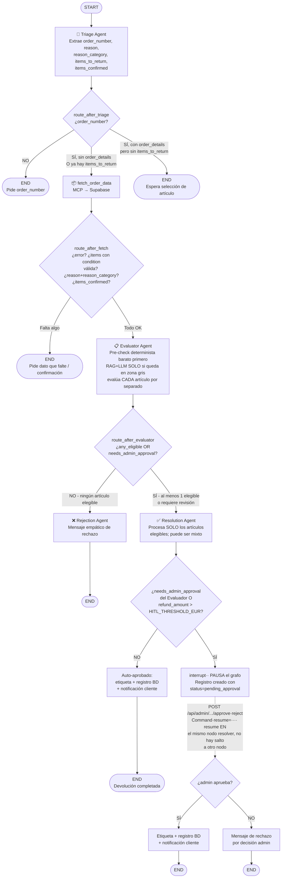
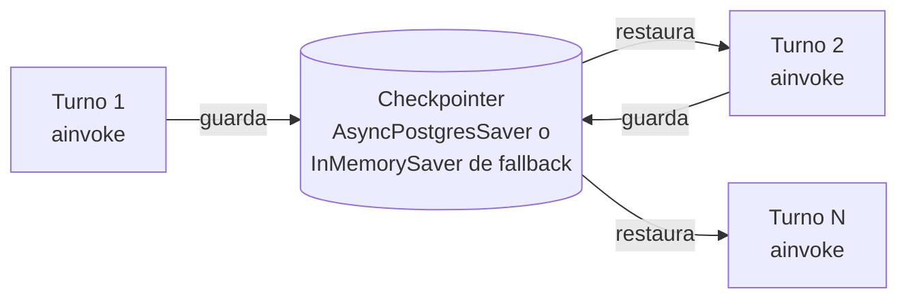

# Diagrama del Grafo de Devoluciones (LangGraph)

> Reflejo del código actual en `backend/agents/graph.py`, `nodes/triage.py`,
> `nodes/evaluator.py`, `nodes/resolution.py` y `nodes/policy_rules.py`.
> Todo el enrutamiento (`route_after_*`) es 100% determinista; el LLM nunca
> decide qué nodo se ejecuta a continuación.

## Flujo general



## Ejemplo de conversación multi-turno

Con la confirmación obligatoria de `items_confirmed` (ver `triage.py`), un
caso típico con varios artículos en el pedido necesita **4 turnos**, no 3:

```mermaid
sequenceDiagram
    participant U as Usuario
    participant D as chat.py (API)
    participant G as LangGraph
    participant T as Triage Agent
    participant CP as Checkpointer
    participant MCP as MCP Server
    participant EV as Evaluator
    participant R as Resolver

    Note over U,MCP: Turno 1 - Saludo, sin order_number
    U->>D: "hola quiero devolver algo"
    D->>G: ainvoke({messages: [Human(...)]})
    G->>CP: Restaurar estado (vacío)
    G->>T: triage_agent(state)
    T-->>G: {order_number: None}
    G->>G: route_after_triage → END (falta order_number)
    G->>CP: Guardar estado
    D-->>U: "¿Cuál es tu número de pedido?"

    Note over U,MCP: Turno 2 - Order number → fetch muestra artículos
    U->>D: "ORD-2026-00177"
    D->>G: ainvoke(...)
    G->>T: triage_agent(state)
    T-->>G: {order_number: "ORD-2026-00177"}
    G->>G: route_after_triage → fetch_order_data<br/>(sin order_details todavía)
    G->>MCP: get_order_details + get_customer_return_history
    MCP-->>G: pedido + historial
    G->>G: fetch_order_data pregunta artículo/motivo/estado
    G->>G: route_after_fetch → END (faltan items/reason/confirmación)
    G->>CP: Guardar estado
    D-->>U: "Estos son los artículos del pedido... ¿cuál, por qué y en qué estado?"

    Note over U,MCP: Turno 3 - Motivo + item (LLM infiere condition, pide confirmación)
    U->>D: "el microondas, está estropeado"
    D->>G: ainvoke(...)
    G->>T: triage_agent(state)
    T->>T: infiere condition=defective;<br/>items_confirmed=False (recién inferido)
    T-->>G: {items_to_return: [...], reason_category: "defective",<br/>items_confirmed: False}
    G->>G: route_after_triage → fetch_order_data<br/>(ya hay order_details E items_to_return)
    G->>G: fetch_order_data: no-op (ya tiene los datos)
    G->>G: route_after_fetch → END (items_confirmed=False)
    G->>CP: Guardar estado
    D-->>U: "Entiendo que el microondas está defectuoso, ¿es correcto?"

    Note over U,MCP: Turno 4 - Confirmación explícita → evalúa y resuelve
    U->>D: "sí, correcto"
    D->>G: ainvoke(...)
    G->>T: triage_agent(state)
    T-->>G: {items_confirmed: True}
    G->>G: route_after_triage → fetch_order_data (no-op)
    G->>G: route_after_fetch → evaluator ✅ (los 4 gates cumplidos)
    G->>EV: evaluator_agent(state)
    EV->>EV: RAG por categoría + policy_rules.py<br/>por artículo (veto/human_review/valid)
    EV-->>G: {items_eligibility: [...], any_eligible: true,<br/>needs_admin_approval: bool}
    G->>G: route_after_evaluator → resolver
    G->>R: resolution_agent(state)
    alt refund_amount <= HITL_THRESHOLD_EUR y sin needs_admin_approval
        R->>R: etiqueta + registro BD + notificación
        R-->>G: Command(goto="__end__")
    else supera umbral o needs_admin_approval
        R->>R: interrupt() → grafo PAUSADO
        Note over U,R: (más tarde) admin aprueba/rechaza vía<br/>POST /api/admin → Command(resume=...)
        R->>R: continúa tras el resume, en el mismo nodo
        R-->>G: Command(goto="__end__")
    end
    G->>CP: Guardar estado final
    D-->>U: "Tu devolución ha sido procesada..." / "Requiere revisión de un admin"
```

## Detalle de cada nodo

| Nodo | Archivo | Qué hace | Usa MCP |
|------|---------|----------|---------|
| `triage` | `nodes/triage.py` | LLM extrae info conversacionalmente; interpreta semánticamente el motivo → `condition`; exige confirmación explícita del cliente (`items_confirmed`) antes de dar por buena la inferencia; gestiona cambio de pedido (`switching_order`) y bloqueo si ya hay una devolución activa | ❌ |
| `fetch_order_data` | `nodes/triage.py` | Consulta pedido + historial en Supabase; detecta devolución activa duplicada (`_check_existing_return`); auto-selecciona artículo único si el `reason_category` ya es conocido (`_auto_select_single_item`); no-op si ya tiene los datos en estado | ✅ supabase:8001 |
| `evaluator` | `nodes/evaluator.py` | Evalúa **cada artículo por separado**, en dos fases (ver `docs/defensaTFM/defenderRAG.md` §4.2): **(1)** pre-check barato con `get_policy_info()` (sin RAG narrativo) + `policy_rules.py::deterministic_check` — si el veredicto ya es `invalid` (plazo, higiene, condición), el artículo queda decidido aquí, sin gastar en RAG ni LLM; **(2)** solo para los artículos que quedan en zona gris (`valid`/`human_review`), búsqueda RAG (`search_return_policy`, una vez por categoría distinta) + LLM. `refund_amount` siempre sale de `compute_refund()`, nunca del LLM. Medido contra el golden dataset: 40.8% de los casos se resuelven sin ninguna llamada a OpenAI (fase 1 sola) | ✅ supabase:8001 |
| `resolver` | `nodes/resolution.py` | Nodo `Command`: filtra solo artículos elegibles (`items_eligibility`), decide HITL (`needs_admin_approval` del Evaluador O `refund_amount > HITL_THRESHOLD_EUR`), llama `interrupt()` si aplica, genera etiqueta, registra devolución (con guard de duplicados), notifica al cliente y redacta mensaje final (puede ser mixto: aprobados + rechazados) | ✅ ambos |
| `reject` | `nodes/resolution.py` | Genera mensaje empático de rechazo cuando **ningún** artículo es elegible | ❌ |

## Rol del Checkpointer



- **Entre nodos** (mismo turno): estado compartido en memoria.
- **Entre turnos** (distintos `ainvoke`/`astream`): estado persistido vía checkpointer.
- **Identificador**: `thread_id` en `config["configurable"]`.
- Si `SUPABASE_DB_URL` no está configurada o falla la conexión a Postgres, el
  grafo cae a `InMemorySaver` (no persistente) con un warning en logs.

## Controles operativos del turno (API)

Añadidos en `backend/api/routers/chat.py`, no representados en el flujo del
grafo pero relevantes para entender su comportamiento en producción:

- **`recursion_limit`** explícito (`GRAPH_RECURSION_LIMIT`, vía `Settings`) en vez
  de depender del default implícito de LangGraph (25).
- **Timeout por turno** (`GRAPH_TURN_TIMEOUT_SECONDS`): cancela el turno si
  algún nodo se queda colgado (LLM/MCP/BD sin responder); en streaming se
  aplica por paso (`__anext__`), no al generador completo.
- **Tope de turnos por conversación** (`MAX_CONVERSATION_TURNS`): corta
  conversaciones sin fin en el mismo `thread_id`.
- **Lock por `thread_id`** (`_ThreadLockRegistry`): serializa peticiones
  solapadas al mismo hilo (doble clic, reintento de red) para no invocar el
  grafo dos veces en paralelo sobre el mismo checkpoint; expulsa entradas
  inactivas para no crecer sin límite.
- **Guard de HITL pendiente**: si `graph.aget_state(...).next` no está vacío
  (el grafo está pausado en un `interrupt()`), no se reinvoca el grafo; se
  informa al cliente que su solicitud sigue en revisión.
