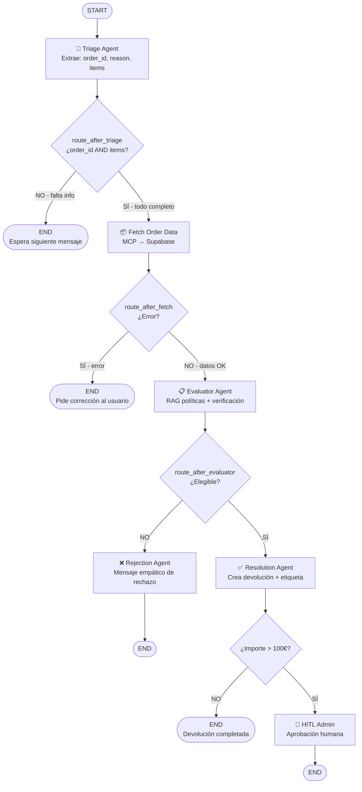
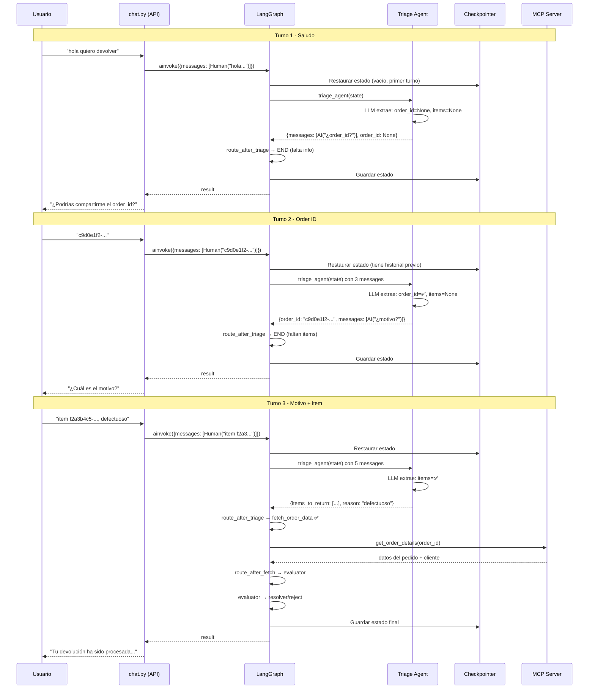
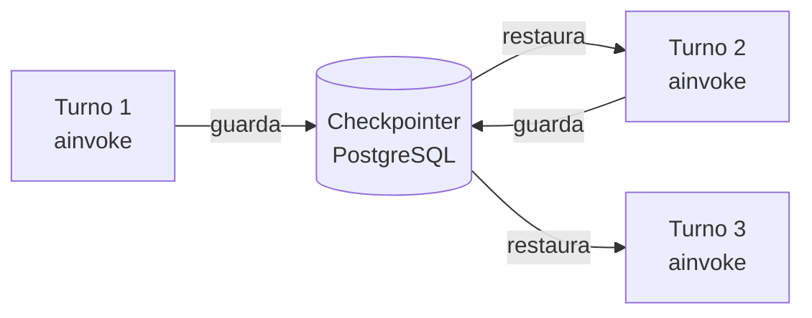

# Diagrama del Grafo de Devoluciones (LangGraph)

## Flujo general

## Ejemplo de conversación multi-turno

## Detalle de cada nodo

| Nodo | Archivo | Qué hace | Usa MCP |
|------|---------|----------|---------|
| `triage` | `nodes/triage.py` | LLM extrae info del cliente conversacionalmente | ❌ |
| `fetch_order_data` | `nodes/triage.py` | Consulta pedido y historial en Supabase | ✅ supabase:8001 |
| `evaluator` | `nodes/evaluator.py` | RAG sobre políticas + verificación de plazos | ✅ supabase:8001 |
| `resolver` | `nodes/resolution.py` | Crea devolución, genera etiqueta, notifica | ✅ ambos |
| `reject` | `nodes/resolution.py` | Genera mensaje empático de rechazo | ❌ |
| `hitl_admin` | `nodes/resolution.py` | Pausa para aprobación humana (>100€) | ❌ |

## Rol del Checkpointer

- **Entre nodos** (mismo turno): estado compartido en memoria
- **Entre turnos** (distintos ainvoke): estado persistido via checkpointer
- **Identificador**: `thread_id` en `config["configurable"]`
