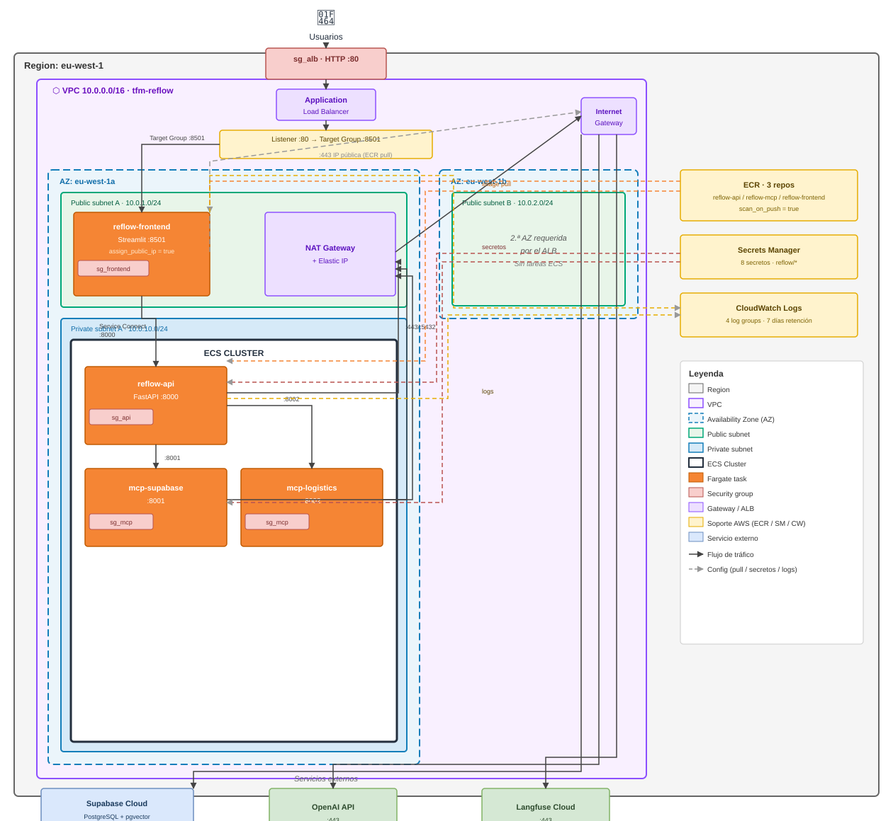

# Diagrama de Infraestructura Cloud (AWS ECS Fargate)

> Reflejo del código Terraform en `infra/` (11 archivos `.tf`).  
> Región: **eu-west-1**. Orquestación: **ECS Fargate** con Service Connect (AWS Cloud Map).  
> Script de despliegue end-to-end: `deploy.sh aws`.

## Topología de red y flujo de tráfico



---

## Servicios ECS

| Servicio | Imagen ECR | CPU / RAM | Subnet | IP pública | Puerto | Health check path |
|----------|-----------|-----------|--------|:----------:|--------|-------------------|
| `fastapi` | `reflow-api:latest` | 512 / 1024 MB | privada A | No | :8000 | `GET /health` |
| `mcp-supabase` | `reflow-mcp:latest` | 256 / 512 MB | privada A | No | :8001 | `GET /mcp` |
| `mcp-logistics` | `reflow-mcp:latest` | 256 / 512 MB | privada A | No | :8002 | `GET /mcp` |
| `frontend` | `reflow-frontend:latest` | 256 / 512 MB | pública A | Sí | :8501 | `GET /_stcore/health` |

Todos los servicios tienen `desired_count = 1` (variable `var.desired_count`).

## Service Connect (AWS Cloud Map)

Comunicación interna sin DNS externo. El cluster ECS usa un namespace HTTP de Cloud Map
(`tfm-reflow`) y cada servicio publica un alias DNS resolvible solo dentro del cluster:

| Alias DNS interno | Puerto | Llamante | Receptor |
|-------------------|--------|----------|----------|
| `http://fastapi:8000` | :8000 | `frontend` | `fastapi` |
| `http://mcp-supabase:8001/mcp` | :8001 | `fastapi` | `mcp-supabase` |
| `http://mcp-logistics:8002/mcp` | :8002 | `fastapi` | `mcp-logistics` |

El frontend no expone ningún alias (solo actúa como cliente de `fastapi`).

## Security groups

| Security group | Ingreso | Egreso |
|----------------|---------|--------|
| `sg_alb` | :80 / :443 desde `allowed_cidr_blocks` | :8501 → `sg_frontend` |
| `sg_frontend` | :8501 desde `sg_alb` | :8000 → `sg_api`; :443 (ECR pull directo) |
| `sg_api` | :8000 desde `sg_frontend` | :8001 / :8002 → `sg_mcp`; :443 (Supabase / OpenAI / ECR); :5432–:6543 (Postgres Supabase) |
| `sg_mcp` | :8001 / :8002 desde `sg_api` | :443 (Supabase / OpenAI / ECR); :5432–:6543 (Postgres Supabase) |

## Repositorios ECR y Dockerfiles

| Repositorio | Dockerfile fuente | CMD por defecto | Política de retención |
|-------------|------------------|-----------------|----------------------|
| `reflow-api` | `Dockerfile.api` | `uvicorn backend.api.main:app --port 8000` | Últimas 5 etiquetas; sin etiqueta → 1 día |
| `reflow-mcp` | `Dockerfile.mcp` | Override por task definition ECS (supabase / logistics) | Últimas 5 etiquetas; sin etiqueta → 1 día |
| `reflow-frontend` | `Dockerfile.frontend` | `streamlit run app.py --port 8501` | Últimas 5 etiquetas; sin etiqueta → 1 día |

## Secrets Manager

Secretos creados con valor `CHANGE_ME` por `terraform apply`. Se rellenan con valores reales
mediante `deploy.sh secrets` (lee `.env` y llama a `aws secretsmanager put-secret-value`).  
Terraform solo gestiona la creación: `lifecycle { ignore_changes = [secret_string] }`.

| Secreto | Variable de entorno | Inyectado en |
|---------|---------------------|-------------|
| `reflow/openai-api-key` | `OPENAI_API_KEY` | fastapi, mcp-supabase |
| `reflow/supabase-url` | `SUPABASE_URL` | fastapi, mcp-supabase, mcp-logistics |
| `reflow/supabase-service-key` | `SUPABASE_SERVICE_KEY` | fastapi, mcp-supabase, mcp-logistics |
| `reflow/supabase-db-url` | `SUPABASE_DB_URL` | fastapi |
| `reflow/jwt-secret` | `JWT_SECRET` | fastapi |
| `reflow/admin-password` | `ADMIN_PASSWORD` | fastapi |
| `reflow/langfuse-secret-key` | `LANGFUSE_SECRET_KEY` | fastapi, mcp-supabase |
| `reflow/langfuse-public-key` | `LANGFUSE_PUBLIC_KEY` | fastapi, mcp-supabase |

## IAM

| Rol | Permisos principales | Propósito |
|-----|---------------------|-----------|
| `reflow-tfm-ecs-execution` | `ecr:GetAuthorizationToken`, `ecr:BatchGetImage`, `secretsmanager:GetSecretValue`, `logs:CreateLogStream / PutLogEvents` | Infraestructura ECS: pull de imágenes, lectura de secretos, escritura de logs |
| `reflow-tfm-ecs-task` | (ninguno actualmente) | Permisos de aplicación en runtime — separación intencional, reservado para extensiones futuras |

## Flujo de despliegue (`deploy.sh aws`)

```
terraform apply
   └─► crea VPC · subnets · IGW · NAT · ALB · ECR · ECS cluster · Secrets Manager · IAM · CWLogs

deploy.sh secrets
   └─► lee .env → aws secretsmanager put-secret-value (8 secretos)

docker build --platform linux/amd64 + push → ECR
   ├─► Dockerfile.api     → reflow-api:latest
   ├─► Dockerfile.mcp     → reflow-mcp:latest
   └─► Dockerfile.frontend → reflow-frontend:latest

aws ecs wait services-stable
   └─► espera a que los 4 servicios ECS arranquen con las nuevas imágenes

terraform output alb_url  →  http://<alb-dns>.eu-west-1.elb.amazonaws.com
```
